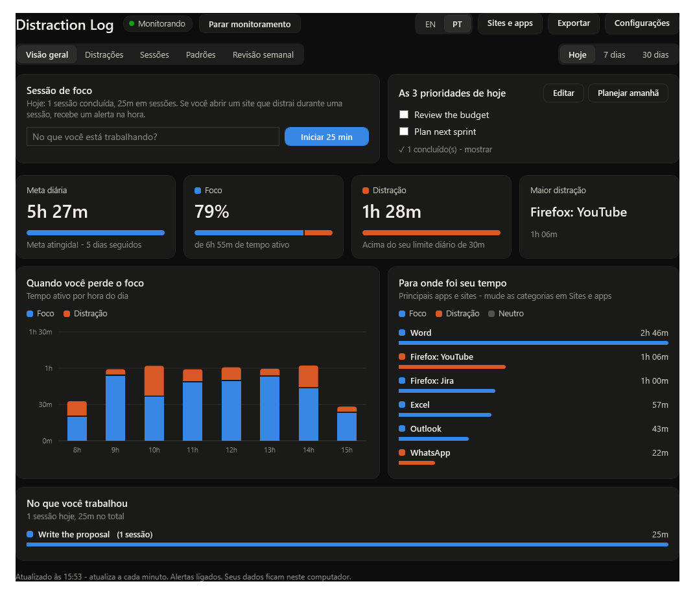

# Distraction Log

Um pequeno app para Windows que mostra para onde vai o seu tempo de trabalho e ajuda você a manter o foco.
Ele registra qual app ou site está na frente, guarda tudo **só no seu computador** e transforma isso
em painéis, alertas, timer de foco, planos diários e semanais e uma revisão semanal.

*Read in English: [README.md](README.md)* (documentação completa)



## Recursos

- **Monitoramento automático** a cada 5 segundos. Dois minutos sem mouse ou teclado contam como ausência.
- **Trabalho, neutro, distração.** YouTube, Instagram, Facebook, TikTok, X, Netflix, Reddit, WhatsApp,
  Twitch e outros contam como distração. Você pode mudar a categoria de qualquer app ou site em **Sites e apps**.
- **Alertas** (notificações do Windows, mesmo com o app fechado): distração contínua (10 min),
  limite diário de distração (30 min), meta diária atingida (4 h), resumo do fim do dia às 18:00,
  lembrete das 3 prioridades de manhã e aviso de revisão semanal na segunda-feira.
- **Timer de foco**: digite a tarefa e clique em **Iniciar 25 min**. Abrir uma distração durante a sessão
  gera um alerta em 15 segundos. Depois vem uma pausa de 5 minutos.
- **Planos**: as 3 prioridades do dia e 3 metas da semana, com caixas de seleção.
- **Painéis**: Visão geral, Distrações, Sessões, Padrões e Revisão semanal.
- **Bloqueio de sites** opcional durante as sessões de foco ou em horários fixos.
- **Exportar** para arquivos CSV que abrem no Excel ou no Google Planilhas.
- **Português e inglês**: botão **EN | PT** no topo.

## Instalação

1. Coloque esta pasta em um lugar fixo, por exemplo `C:\Users\<você>\FocusLog`.
2. Abra o PowerShell na pasta e rode:

   ```powershell
   powershell -ExecutionPolicy Bypass -File setup.ps1
   ```

   Use `-Desktop` para criar também atalhos na área de trabalho.

O monitoramento começa na hora e passa a iniciar sozinho a cada login. Abra pelo menu Iniciar:
**Distraction Log** (clique com o botão direito > *Fixar em Iniciar*).

## Uso no dia a dia

| Para... | Faça isso |
|---|---|
| Abrir o painel | Menu Iniciar > **Distraction Log** |
| Pausar ou retomar | Botão **Parar/Iniciar monitoramento** no app, ou **Distraction Log On-Off** no menu Iniciar |
| Focar em uma tarefa | Digite em **Sessão de foco** e clique em **Iniciar 25 min** |
| Planejar o dia | **As 3 prioridades de hoje** > **Planejar hoje** (ou **Planejar amanhã**) |
| Metas da semana | Aba **Revisão semanal** > **Definir metas** |
| Corrigir uma categoria | **Sites e apps** |
| Mudar metas, limites, timer | **Configurações** |
| Exportar para o Excel | **Exportar** |

## Bloqueio de sites (opcional)

Precisa de permissão de administrador uma vez: **Configurações > Configurar bloqueio de sites** e
clique em **Sim** no aviso do Windows. O WhatsApp não é bloqueado. Para remover: `install-blocker.ps1 -Uninstall`
como administrador.

## Seus dados

Tudo fica nesta pasta, no seu computador. Nada é enviado para fora, exceto quando você usa
**Perguntar ao coach Claude** (envia o resumo `coach-data.md` ao Claude). O registro inclui os
**títulos das janelas**; na exportação dá para deixá-los de fora. O `.gitignore` mantém todos os
arquivos de dados pessoais fora do repositório.

## Desinstalar

```powershell
powershell -ExecutionPolicy Bypass -File setup.ps1 -Uninstall
```

Remove a tarefa, os atalhos e o link, e mantém seus dados. Se configurou o bloqueio de sites,
rode também `install-blocker.ps1 -Uninstall` como administrador.

Mais detalhes (configurações, painéis, arquivos, personalização e solução de problemas) estão no [README.md](README.md).
