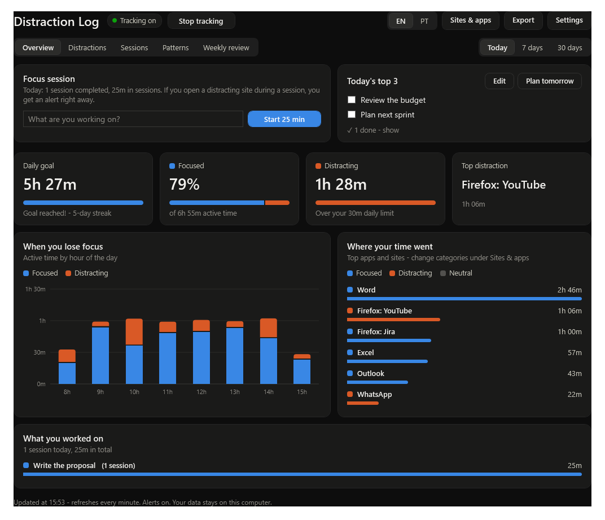
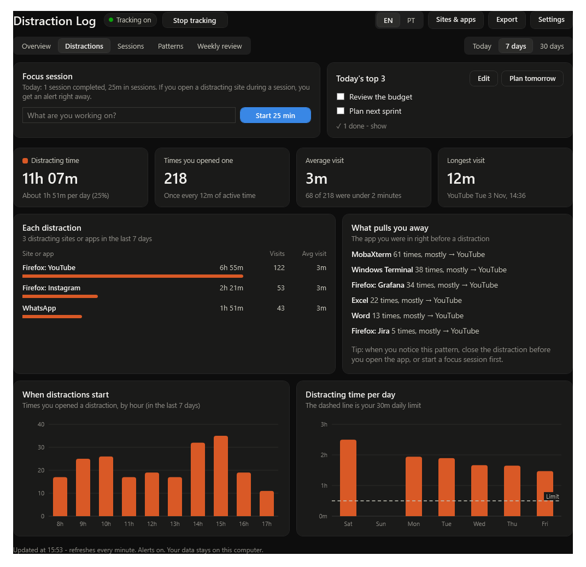
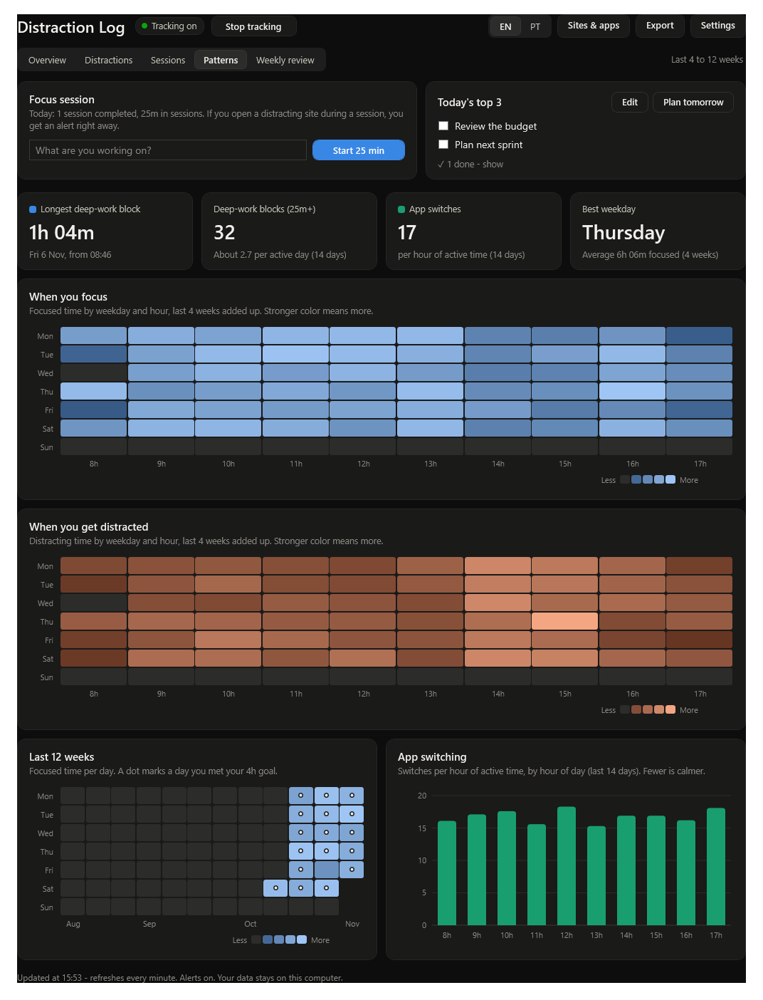
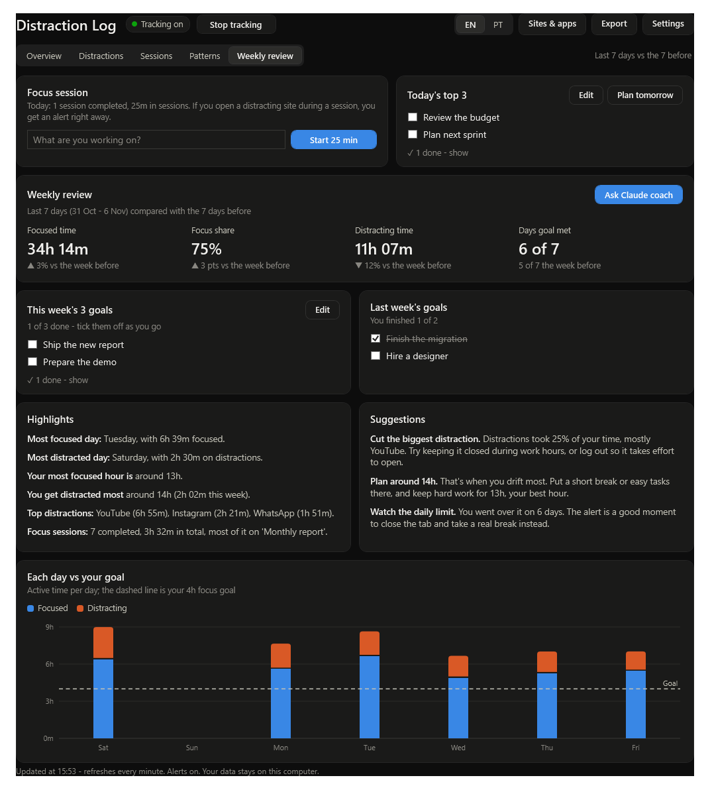
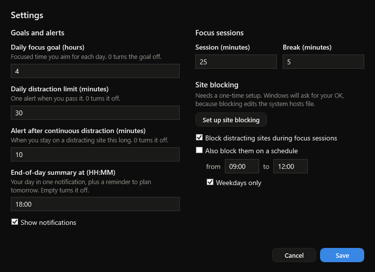
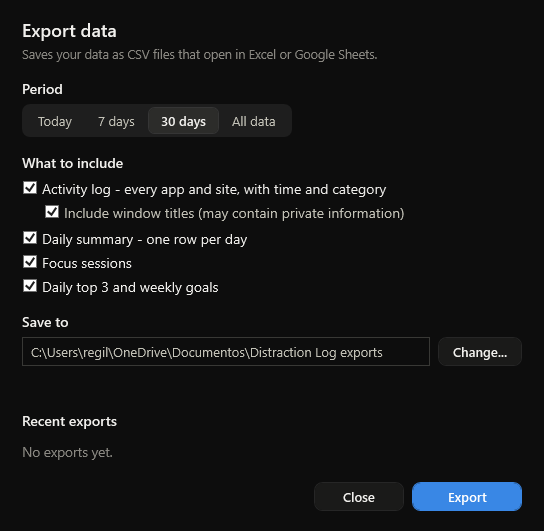
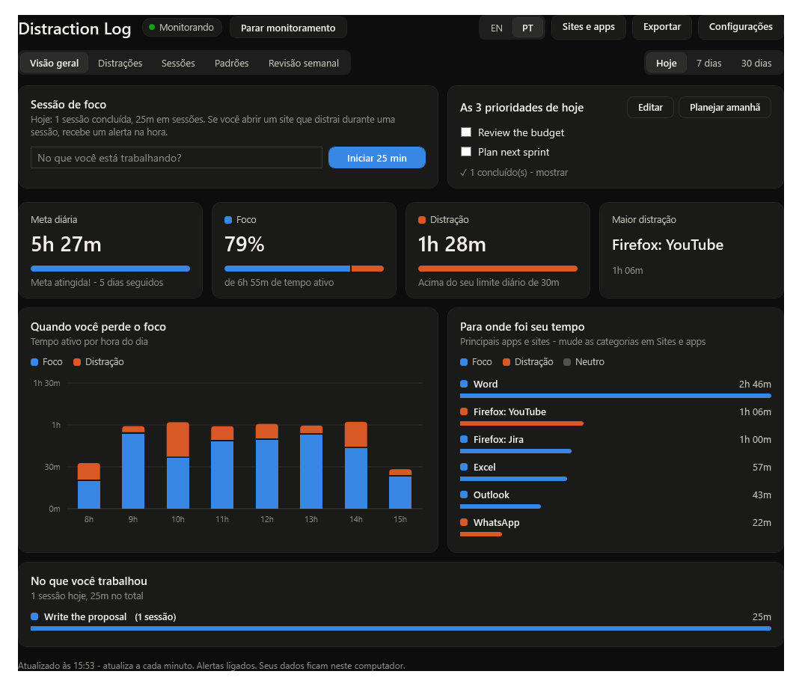

# Distraction Log

[](https://github.com/victorschote/distraction-log/actions/workflows/ci.yml)
[](https://github.com/victorschote/distraction-log/releases/latest)
[](LICENSE)


A small Windows app that shows where your working time goes and helps you stay focused.
It notices which app or website is in front, keeps the record **only on your computer**,
and turns it into dashboards, alerts, a focus timer, daily and weekly plans, and a weekly review.

*Leia em português: [LEIA-ME.md](LEIA-ME.md)*



## Contents

- [Features](#features)
- [Requirements](#requirements)
- [Install](#install)
- [Everyday use](#everyday-use)
- [Dashboards](#dashboards)
- [Settings](#settings)
- [Site blocking (optional)](#site-blocking-optional)
- [Export your data](#export-your-data)
- [Language](#language)
- [Ask Claude coach](#ask-claude-coach)
- [Your data and privacy](#your-data-and-privacy)
- [Files](#files)
- [Customizing](#customizing)
- [Troubleshooting](#troubleshooting)
- [Uninstall](#uninstall)
- [Development](#development)
- [License](#license)

## Features

- **Automatic tracking.** Every 5 seconds it notes the app (and, in browsers, the site) in front.
  Two minutes without mouse or keyboard counts as away and is not recorded.
- **Work, neutral, distracting.** YouTube, Instagram, Facebook, TikTok, X, Netflix, Reddit,
  WhatsApp, Twitch and others count as distracting. You can re-label any app or site.
- **Alerts** (Windows notifications, even when the app is closed):
  - after 10 minutes in a row on a distraction (repeats every 10 minutes);
  - when you pass your daily distraction limit (30 minutes by default);
  - when you reach your daily focus goal (4 hours by default);
  - an end-of-day summary at 18:00, a morning reminder of your top 3,
    and a Monday note that your weekly review is ready.
- **Focus timer.** Type what you are working on and press *Start 25 min*. Opening a distraction
  during a session gives an alert after 15 seconds. A 5-minute break follows.
- **Plans.** Today's top 3 and 3 weekly goals, with check boxes. Finished items fade away.
- **Dashboards.** Overview, Distractions, Sessions, Patterns and Weekly review (see below).
- **Optional site blocking** during focus sessions or at set hours.
- **Export** to CSV files that open in Excel or Google Sheets.
- **English and Portuguese**, switchable with one click.

## Requirements

- Windows 10 or 11
- Windows PowerShell 5.1 (built into Windows)
- No admin rights needed, except for the optional site blocker
- Optional: [Claude Code](https://claude.com/claude-code) for the *Ask Claude coach* button

## Install

1. Download the zip from the [latest release](https://github.com/victorschote/distraction-log/releases/latest)
   (or `git clone` the repository) and put it in a folder that stays put, for example
   `C:\Users\<you>\FocusLog`.
2. Open PowerShell in that folder and run:

   ```powershell
   powershell -ExecutionPolicy Bypass -File setup.ps1
   ```

   Add `-Desktop` to also get desktop shortcuts.

This:

- adds a scheduled task that starts tracking each time you log in (hidden, no window);
- adds **Distraction Log** and **Distraction Log On-Off** to the Start menu
  (right-click > *Pin to Start* or *Pin to taskbar*);
- registers the `distractionlog:` link that notification clicks use;
- starts tracking right away.

## Everyday use

| To... | Do this |
|---|---|
| Open the dashboard | Start menu > **Distraction Log** |
| Pause or resume tracking | **Stop tracking / Start tracking** button in the app, or Start menu > **Distraction Log On-Off** |
| Focus on one task | Type it in **Focus session** and press **Start 25 min** |
| Plan your day | **Today's top 3** > **Plan today** (or **Plan tomorrow** in the evening) |
| Set weekly goals | **Weekly review** tab > **Set goals** |
| Fix a wrong category | **Sites & apps** > choose Work, Neutral or Distracting |
| Change goals, limits, timer | **Settings** |

Tracking turned off stays off after restarts until you turn it on again.

## Dashboards

The tabs at the top switch between dashboards. **Today / 7 days / 30 days** on the right
picks the period.

**Overview**: daily goal, focused share, distracting time against your limit, top distraction,
an hour-by-hour chart, the apps and sites you used most, and what you worked on in focus sessions.

**Distractions**: how often you open distractions, average and longest visits, each distracting
site with visits and time, *what pulls you away* (the app you were in right before), when
distractions start, and distracting time per day against your limit.



**Sessions**: completed vs stopped sessions, completion rate, time in sessions, distraction during
sessions, sessions per day, time per task and recent sessions.

**Patterns**: heatmaps of focus and distraction by weekday and hour (last 4 weeks), a 12-week
calendar with a dot on days you met your goal, app switching per hour, your longest
deep-work block and best weekday.



**Weekly review**: the last 7 days compared with the 7 before, this week's and last week's goals,
highlights, suggestions and each day against your goal.



## Settings



| Setting | Default | Notes |
|---|---|---|
| Daily focus goal | 4 hours | 0 turns it off |
| Daily distraction limit | 30 minutes | one alert per day; 0 turns it off |
| Alert after continuous distraction | 10 minutes | repeats; 0 turns it off |
| End-of-day summary | 18:00 | empty turns it off |
| Show notifications | on | turns all alerts off when unchecked (timer notifications still show) |
| Focus session / break | 25 / 5 minutes | |
| Block distracting sites during focus sessions | on | needs the site blocker |
| Block on a schedule | off, 09:00-12:00, weekdays | needs the site blocker |

Settings are saved in `settings.json`.

## Site blocking (optional)

Blocking works by adding the distracting sites to the Windows `hosts` file, which needs admin
rights once. In the app: **Settings > Set up site blocking**, then click **Yes** on the Windows prompt.
Or run as admin: `install-blocker.ps1`.

- It installs a copy of `blocker.ps1` in `C:\ProgramData\DistractionLog` (only admins can change it)
  and a task that runs it as SYSTEM. It only reads your settings and timer state, and only ever
  writes its own fixed list of sites.
- Blocked: YouTube, Instagram, Facebook, TikTok, X/Twitter, Netflix, Reddit, Twitch, Prime Video,
  Globoplay, Disney+, 9GAG, Pinterest. WhatsApp is left out on purpose.
- Tabs that are already open may keep working for a minute or two.
- To change the list, edit `$Domains` in `blocker.ps1` and run `install-blocker.ps1` again as admin.
- Remove it with `install-blocker.ps1 -Uninstall` (as admin).

## Export your data



**Export** (top right) saves CSV files for a period you choose (today, 7 days, 30 days or all data):

| File | Contents |
|---|---|
| `activity.csv` | every logged piece of time: date, start, end, minutes, app, window title (optional), app or site, category |
| `daily-summary.csv` | one row per day: focused, distracting, neutral and active minutes, focus %, goal met, sessions, top distraction |
| `sessions.csv` | focus sessions: start, end, planned and actual minutes, completed, minutes distracted, task |
| `plans.csv` | daily top 3 and weekly goals, with done or not |

The files use your Windows list separator and decimal mark, so Excel splits the columns
correctly (in Brazil: `;` and `,`). Each export goes into its own dated folder
(default `Documents\Distraction Log exports`). In Portuguese the file names and headers are in Portuguese.

## Language

The **EN | PT** switch at the top changes the whole app, the notifications and the coach between
English and Portuguese, right away. Your own text (tasks, plans, site names) is never translated.



Translations live in `pt.json`: each English text maps to its Portuguese version. `{0}` stands for
any text and `{0#}` for a number or time, for example
`"Start {0#} min": "Iniciar {0} min"`. To add a language, the same approach works with another file.

## Ask Claude coach

In **Weekly review**, **Ask Claude coach** writes a summary of your last 14 days to `coach-data.md`
and opens [Claude Code](https://claude.com/claude-code) in Windows Terminal with it. Claude gives
a short coaching report (what went well, the biggest problems, a plan for the week) and then
answers your questions. Needs Claude Code installed and signed in.

## Your data and privacy

- Everything stays in this folder on your computer. Nothing is sent anywhere.
  The only exception is the coach, which sends `coach-data.md` to Claude when you click the button.
- The log includes **window titles** (for example document names, email subjects, page titles).
  Keep that in mind before sharing exports; the Export window can leave titles out.
- `.gitignore` keeps all personal data files out of the repository.

## Files

| File | Purpose |
|---|---|
| `app.ps1` | the app window (WPF): layout, overview, review, dialogs, translation of the screen |
| `dashboards.ps1` | Distractions, Sessions and Patterns dashboards, heatmaps |
| `export.ps1` | CSV export and the Export window |
| `common.ps1` | shared code: categories, settings, notifications, focus sessions, plans, translation |
| `tracker.ps1` | background tracker and all alerts |
| `toggle.ps1` | turn tracking on/off |
| `coach.ps1` | builds `coach-data.md` and starts Claude |
| `blocker.ps1`, `install-blocker.ps1` | optional site blocker (runs as SYSTEM) |
| `setup.ps1` | install / uninstall for the current user |
| `open-app.vbs`, `run-hidden.vbs` | start the app / tracker without a console window |
| `make-icon.ps1` | draws `app.ico` and `app-icon.png` |
| `report.ps1`, `view.ps1` | older terminal reports (`report.ps1 -Days 7 -Top 15`) |
| `pt.json` | Portuguese texts |

Data files (created as you use it, not in the repository):

| File | Contents |
|---|---|
| `logs\YYYY-MM-DD.tsv` | the activity log: start, seconds, app, window title |
| `sessions.tsv` | finished focus sessions |
| `focus.json` | the running focus session |
| `plans.json` | daily top 3 and weekly goals |
| `settings.json`, `categories.json` | your settings and category choices |
| `alerts.json`, `window.json`, `export-history.tsv` | alert state, window position, past exports |

## Customizing

- **Distracting keywords**: `$Distracting` in `common.ps1` (matched against app name and window title).
- **Friendly app names**: `$Friendly` in `common.ps1`.
- **Apps counted as neutral by default**: `$DefaultNeutral` in `common.ps1`.
- Keep `.ps1` files **ASCII-only**: Windows PowerShell 5.1 misreads other characters in scripts.
  Put text with accents in `pt.json` instead.
- **Self-test**: set `FL_SNAPSHOT` to a folder and run `app.ps1`. It renders every tab and dialog
  to PNG files there and exits, without touching your window settings:

  ```powershell
  $env:FL_SNAPSHOT = "$env:TEMP\fl-shots"; mkdir $env:FL_SNAPSHOT -Force
  powershell -STA -ExecutionPolicy Bypass -File app.ps1
  ```

## Troubleshooting

| Problem | Fix |
|---|---|
| App shows "Tracking off" | Click **Start tracking**. Check the task: `Get-ScheduledTask 'Distraction Log'` |
| No notifications | Windows Settings > System > Notifications: allow *Distraction Log*; check Focus assist / Do not disturb; check **Show notifications** in Settings |
| App doesn't open | Look at `app-error.txt` in this folder |
| Notification clicks do nothing | Run `setup.ps1` again (registers the `distractionlog:` link) |
| Sites not blocked | Set up the blocker (see above); reload the tab; Firefox/Chrome "secure DNS" can bypass the hosts file |
| Excel shows everything in one column | Use Data > From Text/CSV and pick the separator, or check Windows region settings |

## Uninstall

```powershell
powershell -ExecutionPolicy Bypass -File setup.ps1 -Uninstall
```

This removes the task, shortcuts and link, and keeps your data. If you set up the site blocker,
also run `install-blocker.ps1 -Uninstall` as admin. Then delete the folder if you no longer want the data.

## Development

- Tests: `Invoke-Pester .\tests` (Pester 5). They run on a temporary copy, never on your data.
- Every push and pull request runs the tests and renders every screen in English and Portuguese
  on GitHub Actions ([CI](.github/workflows/ci.yml)); the screens are attached to each run.
- Pushing a tag like `v1.1.0` publishes a release with a zip ([release workflow](.github/workflows/release.yml)).
- How to contribute, the coding rules and the release steps: [CONTRIBUTING.md](CONTRIBUTING.md).
- What changed in each version: [CHANGELOG.md](CHANGELOG.md).
- Security design and how to report a problem: [SECURITY.md](SECURITY.md).

## License

[MIT](LICENSE) © 2026 Victor Schote
